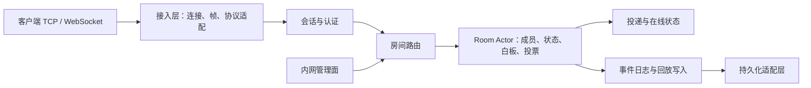

# 架构草案

## 目标

以房间为核心重新建模实时协作业务。协议、传输和存储都是边界适配器，领域规则不依赖它们。

## 服务边界

## 核心模型

- **Identity**：由可信认证系统确定的用户身份。
- **Session**：一次客户端连接，可断开、重连或被替换。
- **Room**：有生命周期、配置和权限策略的协作空间。
- **Membership**：用户/会话加入房间后的身份、角色与权限。
- **Room Actor**：房间状态的唯一写入者，为变更分配房间内序号并维护顺序。
- **Domain Event**：不依赖 protobuf 的内部事件，用于广播、恢复和回放。

## 请求处理路径

1. 接入层解析传输帧和外部协议，生成内部命令。
2. 会话层确认连接身份；房间层校验成员身份、角色和操作权限。
3. 房间执行者按房间顺序验证并应用命令。
4. 为变更产生序号和领域事件；按该操作的持久性策略保存。
5. 向发起者返回结果，并向有权限的成员投递事件。

## 房间状态与持久化

先为每类状态定义是否持久化、何时确认成功、如何恢复。建议用快照加版本化事件日志恢复房间；临时光标等数据不进入回放。持久化写入通过独立适配层完成，写入失败和重试不得无限阻塞房间消息处理。

Redis 可用于短时在线状态、路由租约或缓存。它的 Pub/Sub 不承担权威状态和可恢复事件日志的职责。回放事件按版本化格式组织，存储介质由吞吐和保留要求决定。

## 初期部署

先以一个可部署的 Skynet 应用承载模块化服务，按房间路由到执行者。优先建立清晰所有权、限流和背压边界，再按压测结果决定是否拆分投递或存储服务。
